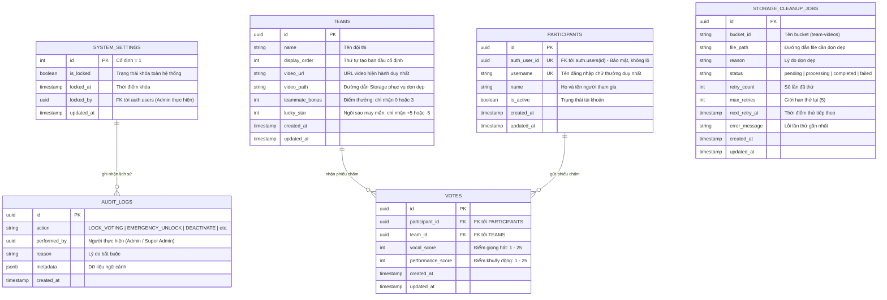

# DATA MODEL SPECIFICATION – HỆ THỐNG BÌNH CHỌN VÀ CHẤM ĐIỂM HỘI THI HÁT

> **Tài liệu:** Thiết kế Kiến trúc Dữ liệu Quan hệ (Relational Data Model & Schema Specification)  
> **Hệ quản trị:** PostgreSQL (trên nền tảng Supabase)  
> **Phiên bản:** 1.5.4 (Explicit Error Mapping Architecture, Pre-acceptance Status Verification & Individual Request Audit)  
> **Phạm vi vòng đời (Scope):** Ứng dụng phục vụ duy nhất một kỳ hội thi văn nghệ, sử dụng một lần (Single-Event Lifecycle).

---

## 1. NGUYÊN TẮC THIẾT KẾ DỮ LIỆU & BẢO MẬT V1.5.4

1. **Phạm vi một kỳ hội thi (Single-Event Lifecycle):**
   - Dữ liệu được thiết kế tối giản, tập trung tối đa cho sự kiện đơn kỳ quy mô ~300 người tham gia, không đa mùa giải.
2. **Nạp danh sách từ Excel (.xlsx) & Mật khẩu cố định `123`:**
   - File Excel gồm đúng 4 cột: `STT`, `username`, `password`, `name`.
   - Backend chuẩn hóa `username` thành chữ thường: `lower(trim(username))`. Mỗi `username` là duy nhất trên toàn hệ thống (`UNIQUE`).
   - Mật khẩu khởi tạo cố định là `123` cho tất cả participant. Cột `password` trong file nếu có sẽ bị bỏ qua và gán cố định `123`.
   - Không yêu cầu đổi mật khẩu lần đầu; không bắt buộc email hoặc số điện thoại thật.
3. **Cơ chế ánh xạ Internal Email an toàn & Pre-flight Check:**
   - Sử dụng biến môi trường cấu hình domain nội bộ `AUTH_INTERNAL_DOMAIN` (chuẩn mặc định theo RFC 6761: `participant.internal` hoặc domain chính thức do người dùng phê duyệt: `${clean_username}@${AUTH_INTERNAL_DOMAIN}`).
   - Người tham gia chỉ nhập `username` và `password 123` trên giao diện, hoàn toàn không tương tác với email nội bộ này.
   - Bắt buộc thực hiện kiểm thử xác thực (Pre-flight Auth Test) tạo và đăng nhập tài khoản mẫu trên môi trường Supabase mục tiêu trước khi nạp chính thức.
4. **Xử lý tài khoản mồ côi khi Import (Orphaned Auth User Cleanup):**
   - Nếu tạo Supabase Auth User (`auth.admin.createUser`) thành công nhưng thao tác lưu bản ghi `participants` liên kết thất bại, backend bắt buộc gọi ngay `auth.admin.deleteUser(auth_user_id)` để rollback dọn dẹp sạch sẽ.
5. **Thống nhất kiểm tra Role từ `app_metadata`:**
   - Toàn bộ các Stored Procedures / RPC và RLS kiểm tra quyền Admin hoặc Super Admin độc quyền từ:
     `auth.jwt() -> 'app_metadata' ->> 'role'`
   - Tuyệt đối cấm sử dụng `auth.jwt() ->> 'role'` hoặc kiểm tra từ `user_metadata`.
   - Quyền Người tham gia (Participant) được định danh nghiêm ngặt bằng liên kết: `participants.auth_user_id = auth.uid()`.
6. **Tối ưu hóa Khóa chấm điểm, Tuần tự hóa giao dịch & Kiến trúc Ánh xạ Lỗi (Error Mapping Architecture):**
   - **Tối ưu hóa thông lượng chấm điểm đồng thời:** Hàm `submit_vote` sử dụng khóa chia sẻ dòng:  
     `SELECT is_locked FROM system_settings WHERE id = 1 FOR SHARE;`  
     Khóa `FOR SHARE` cho phép tất cả các transaction `submit_vote` đồng thời đọc và giữ khóa chia sẻ mà không chặn lẫn nhau, mang lại hiệu năng cao và độ trễ tối thiểu cho 300 khán giả.
   - **Khóa độc quyền của Quản trị viên:** Hàm `lock_voting_system` sử dụng khóa độc quyền dòng:  
     `SELECT is_locked FROM system_settings WHERE id = 1 FOR UPDATE;`  
     Lệnh khóa của Admin sẽ đợi tất cả các transaction chấm điểm đang giữ `FOR SHARE` hoàn tất (commit/abort). Trong thời gian này, mọi transaction chấm điểm mới đến sau sẽ phải xếp hàng sau lệnh `FOR UPDATE` của Admin.
   - **Sau khi Admin commit:** Trạng thái `is_locked = TRUE` được lưu xuống database. Các transaction đến sau khi có được `FOR SHARE` sẽ đọc thấy `is_locked = TRUE` và bị từ chối ngay lập tức.
   - **Kiến trúc ánh xạ lỗi `ERR_VOTING_LOCKED` sang HTTP 403:**
     - *Phân định rạch ròi trách nhiệm tầng:* Không mặc định PostgreSQL `RAISE EXCEPTION` tự động chuyển thành HTTP 403 trên PostgREST/Supabase (mặc định PostgREST có thể trả 400 Bad Request hoặc 500).
     - *Tầng Database (PL/pgSQL):* Thiết lập `PERFORM set_config('response.status', '403', true);` trước khi phát sinh lỗi, kèm `MESSAGE = 'Đã khóa chấm điểm'` và `DETAIL = 'ERR_VOTING_LOCKED'`.
     - *Tầng Client SDK Wrapper / Gateway:* Đảm bảo kiểm tra lỗi trả về từ PostgREST, chuẩn hóa và đảm bảo response cuối cùng đến tay client luôn là: **HTTP 403 Forbidden**, code: `ERR_VOTING_LOCKED`, message: **“Đã khóa chấm điểm”**.
     - *Điều kiện bắt buộc trước khi nghiệm thu (Pre-acceptance Test Condition):* Bắt buộc kiểm thử thực tế hành vi trả lỗi của PostgREST trên môi trường Supabase mục tiêu trước khi nghiệm thu.
   - **Phòng thủ chiều sâu (Defense-in-Depth):* Trigger `trg_enforce_voting_lock` trên bảng `votes` cũng thực hiện `SELECT is_locked FROM system_settings WHERE id = 1 FOR SHARE` trên cả `BEFORE INSERT OR UPDATE`, bảo đảm không có bất kỳ con đường ghi nào có thể lọt qua cơ chế khóa.
   - Cấm Client ghi trực tiếp (`INSERT, UPDATE, DELETE`) vào bảng `votes` qua REST API; mọi thao tác chấm điểm bắt buộc 100% phải đi qua RPC `submit_vote`.
7. **Bảo vệ quyền riêng tư của Người tham gia (Participant Privacy):**
   - Không cần che giấu phiếu chấm cá nhân của nhau.
   - Bảng `participants` chỉ công khai các trường cần thiết phục vụ hiển thị qua View `view_participants_public`: `id`, `username`, `name`, `is_active`.
   - **Tuyệt đối không để lộ `auth_user_id`** của người khác cho khán giả hoặc người dùng thông thường. Cấu hình RLS chặt chẽ trên bảng gốc `participants` để chặn việc đọc `auth_user_id` của tài khoản khác.
8. **Duy trì các bất biến nghiệp vụ cốt lõi:**
   - Mỗi người chỉ có duy nhất 1 phiếu cho mỗi đội thi (`CONSTRAINT unique_participant_team UNIQUE (participant_id, team_id)`).
   - Điểm giọng hát và khuấy động sân khấu là số nguyên từ 1 đến 25.
   - Người tham gia chỉ được phép tạo hoặc sửa phiếu của chính mình (thông qua `submit_vote` tự trích xuất danh tính từ `auth.uid()`).
   - Không thể giả mạo `participant_id` khi gửi hoặc cập nhật phiếu.
   - Bảng điểm cố định 4 cột: Tên đội, Điểm khán giả, Điểm thưởng đồng đội, Ngôi sao may mắn. Không tự ý thêm cột điểm mới.
9. **Quy trình thay thế video an toàn 2 pha & Bảng `storage_cleanup_jobs`:**
   - Thay video an toàn 6 bước: Upload file mới $\to$ Nếu upload lỗi thì dừng và giữ video cũ $\to$ Cập nhật database $\to$ Nếu DB lỗi thì rollback giữ video cũ và dọn dẹp file mới qua `storage_cleanup_jobs` $\to$ Cập nhật DB thành công mới xóa video cũ $\to$ Nếu xóa video cũ lỗi thì ghi nhận vào `storage_cleanup_jobs` để retry sau.
   - Xóa video hoàn toàn: Admin xác nhận $\to$ Cập nhật DB thành `NULL` $\to$ Xóa file Storage. Khi đội chưa có video, database từ chối mọi yêu cầu chấm hoặc sửa điểm.
10. **An toàn hàm SECURITY DEFINER:**
    - Toàn bộ hàm SQL mang thuộc tính `SECURITY DEFINER` bắt buộc khai báo cố định `SET search_path = public, pg_temp;` và thu hồi quyền thực thi mặc định: `REVOKE EXECUTE ... FROM public, anon;`.

---

## 2. SƠ ĐỒ THỰC THỂ QUAN HỆ (ENTITY RELATIONSHIP DIAGRAM)



---

## 3. ĐẶC TẢ CHI TIẾT CÁC BẢNG DỮ LIỆU

### 3.1. Bảng `system_settings` (Cấu hình và Trạng thái phiên thi)
Bảng đóng vai trò đối tượng khóa tuần tự hóa toàn hệ thống (`FOR SHARE` cho cử tri, `FOR UPDATE` cho quản trị viên). Luôn chỉ chứa đúng 1 dòng (`id = 1`).

| Tên trường | Kiểu dữ liệu | Ràng buộc | Diễn giải |
|---|---|---|---|
| `id` | `INTEGER` | `PRIMARY KEY, DEFAULT 1, CHECK (id = 1)` | Khóa chính cố định = 1 |
| `is_locked` | `BOOLEAN` | `NOT NULL, DEFAULT FALSE` | Cờ khóa chấm điểm (`TRUE` = Đã khóa) |
| `locked_at` | `TIMESTAMPTZ` | `NULLABLE` | Thời điểm khóa có hiệu lực |
| `locked_by` | `UUID` | `NULLABLE, REFERENCES auth.users(id)` | Admin thực hiện khóa |
| `created_at` | `TIMESTAMPTZ` | `NOT NULL, DEFAULT NOW()` | Thời điểm khởi tạo |
| `updated_at` | `TIMESTAMPTZ` | `NOT NULL, DEFAULT NOW()` | Thời điểm cập nhật trạng thái gần nhất |

### 3.2. Bảng `teams` (Danh sách Đội thi)
Quản lý các đội thi tham gia hội diễn văn nghệ. Thứ tự hiển thị cố định theo `display_order`.

| Tên trường | Kiểu dữ liệu | Ràng buộc | Diễn giải |
|---|---|---|---|
| `id` | `UUID` | `PRIMARY KEY, DEFAULT gen_random_uuid()` | Mã định danh duy nhất của đội thi |
| `name` | `VARCHAR(255)` | `NOT NULL, CHECK (length(trim(name)) > 0)` | Tên đội thi |
| `display_order` | `INTEGER` | `NOT NULL` | Thứ tự hiển thị tạo ban đầu. Cố định, không đổi |
| `video_url` | `TEXT` | `NULLABLE` | URL video hiện hành duy nhất |
| `video_path` | `TEXT` | `NULLABLE` | Đường dẫn file trên Supabase Storage phục vụ dọn dẹp |
| `teammate_bonus` | `INTEGER` | `NOT NULL, DEFAULT 0, CHECK (teammate_bonus IN (0, 3))` | Điểm thưởng đồng đội (Chỉ nhận 0 hoặc 3) |
| `lucky_star` | `INTEGER` | `NOT NULL, DEFAULT 5, CHECK (lucky_star IN (5, -5))` | Ngôi sao may mắn (Chỉ nhận +5 hoặc -5) |
| `created_at` | `TIMESTAMPTZ` | `NOT NULL, DEFAULT NOW()` | Thời điểm tạo đội |
| `updated_at` | `TIMESTAMPTZ` | `NOT NULL, DEFAULT NOW()` | Thời điểm chỉnh sửa gần nhất |

### 3.3. Bảng `participants` (Danh sách Người tham gia / Khán giả)
Quản lý ~300 khán giả tham gia chương trình.

| Tên trường | Kiểu dữ liệu | Ràng buộc | Diễn giải |
|---|---|---|---|
| `id` | `UUID` | `PRIMARY KEY, DEFAULT gen_random_uuid()` | Khóa chính nội bộ của người tham gia |
| `auth_user_id` | `UUID` | `NOT NULL, UNIQUE, REFERENCES auth.users(id) ON DELETE CASCADE` | Khóa ngoại liên kết 1-1 với Supabase Auth. **Trường nhạy cảm, không công khai** |
| `username` | `VARCHAR(64)` | `NOT NULL, UNIQUE, CHECK (username = lower(trim(username)) AND length(username) > 0)` | Tên đăng nhập chữ thường chuẩn hóa |
| `name` | `VARCHAR(255)` | `NULLABLE` | Họ và tên hiển thị |
| `is_active` | `BOOLEAN` | `NOT NULL, DEFAULT TRUE` | Trạng thái: `TRUE` = Hoạt động, `FALSE` = Vô hiệu hóa |
| `created_at` | `TIMESTAMPTZ` | `NOT NULL, DEFAULT NOW()` | Thời điểm tạo |
| `updated_at` | `TIMESTAMPTZ` | `NOT NULL, DEFAULT NOW()` | Thời điểm cập nhật |

> **Quy định bảo mật quyền riêng tư tài khoản:**  
> - Bảng `participants` **tuyệt đối không chứa cột mật khẩu**. Mật khẩu cố định `123` được hash lưu trữ an toàn duy nhất trong `auth.users`.  
> - Trường `auth_user_id` chỉ được truy cập bởi Admin/Super Admin hoặc bản thân người dùng đó (`auth_user_id = auth.uid()`).  
> - Mọi truy vấn công khai danh sách người tham gia chỉ được phép đọc thông qua `view_participants_public` (trả về đúng 4 trường: `id`, `username`, `name`, `is_active`). Tuyệt đối không để lộ `auth_user_id`.

### 3.4. Bảng `votes` (Phiếu chấm điểm của Khán giả)
Lưu trữ các phiếu đánh giá của từng người tham gia cho từng đội thi.

| Tên trường | Kiểu dữ liệu | Ràng buộc | Diễn giải |
|---|---|---|---|
| `id` | `UUID` | `PRIMARY KEY, DEFAULT gen_random_uuid()` | Mã định danh của phiếu chấm |
| `participant_id` | `UUID` | `NOT NULL, REFERENCES participants(id) ON DELETE CASCADE` | Khán giả thực hiện chấm điểm |
| `team_id` | `UUID` | `NOT NULL, REFERENCES teams(id) ON DELETE CASCADE` | Đội thi được chấm điểm |
| `vocal_score` | `INTEGER` | `NOT NULL, CHECK (vocal_score >= 1 AND vocal_score <= 25)` | Điểm giọng hát (Số nguyên: 1 đến 25) |
| `performance_score` | `INTEGER` | `NOT NULL, CHECK (performance_score >= 1 AND performance_score <= 25)` | Điểm khuấy động (Số nguyên: 1 đến 25) |
| `created_at` | `TIMESTAMPTZ` | `NOT NULL, DEFAULT NOW()` | Thời điểm gửi phiếu lần đầu |
| `updated_at` | `TIMESTAMPTZ` | `NOT NULL, DEFAULT NOW()` | Thời điểm cập nhật phiếu chấm gần nhất |

**Ràng buộc cốt lõi:**
- `CONSTRAINT unique_participant_team UNIQUE (participant_id, team_id)`  
  *Ý nghĩa:* Mỗi người tham gia chỉ có duy nhất 1 bản ghi phiếu chấm cho 1 đội thi. Khi chấm lại, bắt buộc UPDATE trên bản ghi này.

### 3.5. Bảng `storage_cleanup_jobs` (Quản lý hàng đợi dọn dẹp Storage)
Lưu lại các công việc dọn dẹp file Storage (file video cũ bị thay thế hoặc file video mới mồ côi khi cập nhật DB thất bại) để xử lý dọn dẹp an toàn có cơ chế thử lại.

| Tên trường | Kiểu dữ liệu | Ràng buộc | Diễn giải |
|---|---|---|---|
| `id` | `UUID` | `PRIMARY KEY, DEFAULT gen_random_uuid()` | Mã định danh công việc |
| `bucket_id` | `VARCHAR(64)` | `NOT NULL, DEFAULT 'team-videos'` | Tên Storage Bucket |
| `file_path` | `TEXT` | `NOT NULL` | Đường dẫn file trên Storage cần xóa |
| `reason` | `VARCHAR(128)` | `NOT NULL` | Lý do xóa (`REPLACE_VIDEO`, `DELETE_VIDEO`, `ROLLBACK_NEW_VIDEO`) |
| `status` | `VARCHAR(32)` | `NOT NULL, DEFAULT 'pending', CHECK (status IN ('pending', 'processing', 'completed', 'failed'))` | Trạng thái xử lý |
| `retry_count` | `INTEGER` | `NOT NULL, DEFAULT 0` | Số lần đã thực hiện thử lại |
| `max_retries` | `INTEGER` | `NOT NULL, DEFAULT 5` | Số lần thử lại tối đa trước khi báo lỗi vĩnh viễn |
| `next_retry_at` | `TIMESTAMPTZ` | `NOT NULL, DEFAULT NOW()` | Thời điểm kích hoạt lần thử tiếp theo |
| `error_message` | `TEXT` | `NULLABLE` | Thông điệp lỗi của lần xóa thất bại gần nhất |
| `created_at` | `TIMESTAMPTZ` | `NOT NULL, DEFAULT NOW()` | Thời điểm tạo job |
| `updated_at` | `TIMESTAMPTZ` | `NOT NULL, DEFAULT NOW()` | Thời điểm cập nhật trạng thái job |

### 3.6. Bảng `audit_logs` (Nhật ký hành động quản trị)
Ghi nhận các sự kiện hệ thống quan trọng. Bảng chỉ cho phép ghi thêm (Append-only).

| Tên trường | Kiểu dữ liệu | Ràng buộc | Diễn giải |
|---|---|---|---|
| `id` | `UUID` | `PRIMARY KEY, DEFAULT gen_random_uuid()` | Mã định danh log |
| `action` | `VARCHAR(64)` | `NOT NULL` | `LOCK_VOTING`, `EMERGENCY_UNLOCK`, `UPDATE_PARTICIPANT_STATUS`, `BATCH_DEACTIVATE_PARTICIPANTS` |
| `performed_by` | `UUID` | `NOT NULL, REFERENCES auth.users(id)` | ID tài khoản Admin hoặc Super Admin thực hiện |
| `reason` | `TEXT` | `NOT NULL` | Lý do bắt buộc cho mọi hành vi can thiệp quản trị |
| `metadata` | `JSONB` | `DEFAULT '{}'::jsonb` | Dữ liệu ngữ cảnh bổ sung (IP, User Agent, số lượng bản ghi) |
| `created_at` | `TIMESTAMPTZ` | `NOT NULL, DEFAULT NOW()` | Thời điểm hành động diễn ra |

---

## 4. BẢNG ĐIỂM TỔNG HỢP & VIEW CÔNG KHAI NGƯỜI THAM GIA

### 4.1. View Công Khai Người Tham Gia (`view_participants_public`)
Nhằm bảo vệ tuyệt đối trường nhạy cảm `auth_user_id` và các thông tin định danh nội bộ, hệ thống cung cấp View công khai cho toàn thể người dùng. View trả về chính xác 4 trường: `id`, `username`, `name`, `is_active`.
```sql
CREATE OR REPLACE VIEW view_participants_public AS
SELECT 
    id,
    username,
    name,
    is_active
FROM participants;

-- Phân quyền truy cập view:
GRANT SELECT ON view_participants_public TO anon, authenticated;
```

### 4.2. Bảng Điểm Tổng Hợp An Toàn (`get_team_board`)
Hàm tổng hợp `get_team_board()` tính điểm trung bình cộng khán giả tại database:
- Hiển thị đúng 4 cột nghiệp vụ:
  1. Tên đội thi (`team_name`)
  2. Điểm khán giả (`display_audience_score` - làm tròn 2 chữ số thập phân, nếu 0 phiếu thì trả về `"Chưa có điểm"`)
  3. Điểm thưởng đồng đội (`teammate_bonus`: 0 hoặc 3)
  4. Ngôi sao may mắn (`lucky_star`: +5 hoặc -5)
- Không thêm bất kỳ cột điểm tổng hay trường số liệu dư thừa nào.
- Thứ tự hiển thị cố định theo `display_order` ban đầu của Admin.

```sql
CREATE OR REPLACE FUNCTION get_team_board()
RETURNS TABLE (
    team_id UUID,
    team_name VARCHAR(255),
    display_order INT,
    video_url TEXT,
    teammate_bonus INT,
    lucky_star INT,
    valid_vote_count BIGINT,
    raw_audience_score NUMERIC,
    display_audience_score TEXT
)
LANGUAGE sql
STABLE
SECURITY DEFINER
SET search_path = public, pg_temp
AS $$
    SELECT 
        t.id AS team_id,
        t.name AS team_name,
        t.display_order,
        t.video_url,
        t.teammate_bonus,
        t.lucky_star,
        COUNT(v.id) AS valid_vote_count,
        ROUND(AVG(v.vocal_score + v.performance_score), 2) AS raw_audience_score,
        CASE 
            WHEN COUNT(v.id) = 0 THEN 'Chưa có điểm'
            ELSE TO_CHAR(ROUND(AVG(v.vocal_score + v.performance_score), 2), 'FM999999990.##')
        END AS display_audience_score
    FROM teams t
    LEFT JOIN votes v ON t.id = v.team_id
    GROUP BY t.id, t.name, t.display_order, t.video_url, t.teammate_bonus, t.lucky_star
    ORDER BY t.display_order ASC;
$$;

REVOKE EXECUTE ON FUNCTION get_team_board() FROM public;
GRANT EXECUTE ON FUNCTION get_team_board() TO anon, authenticated;
```

---

## 5. DATABASE PROCEDURES & TRIGGERS BẢO VỆ TUYỆT ĐỐI

### 5.1. Trigger Chặn Ghi Sau Khi Khóa Đồng Bộ Khóa Hàng (`trg_enforce_voting_lock`)
- **Sự kiện kích hoạt:** `BEFORE INSERT OR UPDATE` trên bảng `votes`.
- **Cơ chế khóa hàng tương thích:** Thực thi `SELECT is_locked FROM system_settings WHERE id = 1 FOR SHARE`.
- **Cơ chế thiết lập HTTP Status:** Gọi `PERFORM set_config('response.status', '403', true);` để truyền tải tín hiệu mã HTTP 403 Forbidden tới PostgREST layer.
```sql
CREATE OR REPLACE FUNCTION fn_enforce_voting_lock()
RETURNS TRIGGER
LANGUAGE plpgsql
SECURITY DEFINER
SET search_path = public, pg_temp
AS $$
DECLARE
    v_is_locked BOOLEAN;
BEGIN
    SELECT is_locked INTO v_is_locked 
    FROM system_settings 
    WHERE id = 1 
    FOR SHARE;

    IF v_is_locked = TRUE THEN
        PERFORM set_config('response.status', '403', true);
        RAISE EXCEPTION 'ERR_VOTING_LOCKED' 
            USING MESSAGE = 'Đã khóa chấm điểm',
                  DETAIL = 'ERR_VOTING_LOCKED';
    END IF;
    RETURN NEW;
END;
$$;

DROP TRIGGER IF EXISTS trg_enforce_voting_lock ON votes;
CREATE TRIGGER trg_enforce_voting_lock
BEFORE INSERT OR UPDATE ON votes
FOR EACH ROW EXECUTE FUNCTION fn_enforce_voting_lock();
```

### 5.2. Trigger Kiểm Tra Video Cho Cả INSERT và UPDATE (`trg_enforce_team_video`)
```sql
CREATE OR REPLACE FUNCTION fn_enforce_team_video()
RETURNS TRIGGER
LANGUAGE plpgsql
SECURITY DEFINER
SET search_path = public, pg_temp
AS $$
DECLARE
    v_video_url TEXT;
BEGIN
    SELECT video_url INTO v_video_url FROM teams WHERE id = NEW.team_id;
    IF v_video_url IS NULL OR length(trim(v_video_url)) = 0 THEN
        PERFORM set_config('response.status', '400', true);
        RAISE EXCEPTION 'ERR_NO_VIDEO' 
            USING MESSAGE = 'Đội thi chưa có video dự thi, không thể chấm điểm.',
                  DETAIL = 'ERR_NO_VIDEO';
    END IF;
    RETURN NEW;
END;
$$;

DROP TRIGGER IF EXISTS trg_enforce_team_video ON votes;
CREATE TRIGGER trg_enforce_team_video
BEFORE INSERT OR UPDATE ON votes
FOR EACH ROW EXECUTE FUNCTION fn_enforce_team_video();
```

### 5.3. Trigger Kiểm Tra Tài Khoản Hoạt Động (`trg_enforce_active_participant`)
```sql
CREATE OR REPLACE FUNCTION fn_enforce_active_participant()
RETURNS TRIGGER
LANGUAGE plpgsql
SECURITY DEFINER
SET search_path = public, pg_temp
AS $$
DECLARE
    v_is_active BOOLEAN;
BEGIN
    SELECT is_active INTO v_is_active FROM participants WHERE id = NEW.participant_id;
    IF v_is_active IS DISTINCT FROM TRUE THEN
        PERFORM set_config('response.status', '403', true);
        RAISE EXCEPTION 'ERR_ACCOUNT_DEACTIVATED' 
            USING MESSAGE = 'Tài khoản người tham gia đã bị vô hiệu hóa bởi Ban tổ chức.',
                  DETAIL = 'ERR_ACCOUNT_DEACTIVATED';
    END IF;
    RETURN NEW;
END;
$$;

DROP TRIGGER IF EXISTS trg_enforce_active_participant ON votes;
CREATE TRIGGER trg_enforce_active_participant
BEFORE INSERT OR UPDATE ON votes
FOR EACH ROW EXECUTE FUNCTION fn_enforce_active_participant();
```

### 5.4. Procedure Chấm Điểm Tối Ưu Đồng Thời (`submit_vote`)
Sử dụng `SELECT is_locked FROM system_settings WHERE id = 1 FOR SHARE`.
- `FOR SHARE` cho phép ~300 người chấm điểm đồng thời mà không bị khóa chặn lẫn nhau.
- Xung đột có kiểm soát với `lock_voting_system` (`FOR UPDATE`): Admin chỉ có thể khóa khi các transaction `FOR SHARE` đang chạy hoàn tất.
- Khi Admin đã commit khóa, mọi lượt gọi `submit_vote` đến sau nhận được `is_locked = TRUE` và bị từ chối ngay lập tức: thiết lập HTTP 403 và thông báo **“Đã khóa chấm điểm”**.
- Sử dụng mệnh đề `UPSERT`: `ON CONFLICT (participant_id, team_id) DO UPDATE`.
```sql
CREATE OR REPLACE FUNCTION submit_vote(p_team_id UUID, p_vocal INT, p_performance INT)
RETURNS JSONB
LANGUAGE plpgsql
SECURITY DEFINER
SET search_path = public, pg_temp
AS $$
DECLARE
    v_participant_id UUID;
    v_is_locked BOOLEAN;
    v_video_url TEXT;
    v_vote_id UUID;
BEGIN
    -- 1. Khóa chia sẻ dòng (FOR SHARE): Tối ưu cho 300 người chấm đồng thời không chặn nhau, nhưng sẽ chặn/xung đột với FOR UPDATE của Admin
    SELECT is_locked INTO v_is_locked 
    FROM system_settings 
    WHERE id = 1 
    FOR SHARE;

    IF v_is_locked = TRUE THEN
        PERFORM set_config('response.status', '403', true);
        RAISE EXCEPTION 'ERR_VOTING_LOCKED' 
            USING MESSAGE = 'Đã khóa chấm điểm',
                  DETAIL = 'ERR_VOTING_LOCKED';
    END IF;

    -- 2. Chống giả mạo participant_id: Trích xuất trực tiếp từ auth.uid() của JWT session
    SELECT id INTO v_participant_id 
    FROM participants 
    WHERE auth_user_id = auth.uid() AND is_active = TRUE;

    IF v_participant_id IS NULL THEN
        PERFORM set_config('response.status', '403', true);
        RAISE EXCEPTION 'ERR_ACCOUNT_DEACTIVATED' 
            USING MESSAGE = 'Tài khoản không hợp lệ hoặc đã bị vô hiệu hóa bởi Ban tổ chức.',
                  DETAIL = 'ERR_ACCOUNT_DEACTIVATED';
    END IF;

    -- 3. Kiểm tra video dự thi của đội
    SELECT video_url INTO v_video_url FROM teams WHERE id = p_team_id;
    IF v_video_url IS NULL OR length(trim(v_video_url)) = 0 THEN
        PERFORM set_config('response.status', '400', true);
        RAISE EXCEPTION 'ERR_NO_VIDEO' 
            USING MESSAGE = 'Đội thi chưa có video dự thi, không thể chấm điểm.',
                  DETAIL = 'ERR_NO_VIDEO';
    END IF;

    -- 4. Kiểm tra thang điểm hợp lệ (Số nguyên: 1 đến 25)
    IF p_vocal < 1 OR p_vocal > 25 OR p_performance < 1 OR p_performance > 25 THEN
        PERFORM set_config('response.status', '400', true);
        RAISE EXCEPTION 'ERR_INVALID_SCORE_RANGE' 
            USING MESSAGE = 'Điểm chấm phải là số nguyên từ 1 đến 25.',
                  DETAIL = 'ERR_INVALID_SCORE_RANGE';
    END IF;

    -- 5. Thực hiện UPSERT an toàn dựa trên UNIQUE(participant_id, team_id)
    INSERT INTO votes (participant_id, team_id, vocal_score, performance_score, updated_at)
    VALUES (v_participant_id, p_team_id, p_vocal, p_performance, NOW())
    ON CONFLICT (participant_id, team_id)
    DO UPDATE SET 
        vocal_score = EXCLUDED.vocal_score,
        performance_score = EXCLUDED.performance_score,
        updated_at = NOW()
    RETURNING id INTO v_vote_id;

    RETURN jsonb_build_object(
        'success', true,
        'message', 'Phiếu chấm đã được ghi nhận thành công.',
        'data', jsonb_build_object(
            'vote_id', v_vote_id,
            'team_id', p_team_id,
            'vocal_score', p_vocal,
            'performance_score', p_performance,
            'total_score', (p_vocal + p_performance)
        )
    );
END;
$$;

REVOKE EXECUTE ON FUNCTION submit_vote(UUID, INT, INT) FROM public, anon;
GRANT EXECUTE ON FUNCTION submit_vote(UUID, INT, INT) TO authenticated;
```

### 5.5. Procedure Khóa Chấm Điểm Độc Quyền (`lock_voting_system`)
Sử dụng `SELECT is_locked FROM system_settings WHERE id = 1 FOR UPDATE`.
```sql
CREATE OR REPLACE FUNCTION lock_voting_system()
RETURNS JSONB
LANGUAGE plpgsql
SECURITY DEFINER
SET search_path = public, pg_temp
AS $$
DECLARE
    v_user_role TEXT;
    v_current_locked BOOLEAN;
    v_now TIMESTAMPTZ := NOW();
BEGIN
    -- 1. Xác thực quyền Admin từ app_metadata
    v_user_role := (auth.jwt() -> 'app_metadata' ->> 'role');
    IF v_user_role IS DISTINCT FROM 'admin' AND v_user_role IS DISTINCT FROM 'super_admin' THEN
        PERFORM set_config('response.status', '403', true);
        RAISE EXCEPTION 'ERR_UNAUTHORIZED_ACCESS' 
            USING MESSAGE = 'Bạn không có quyền thực hiện thao tác này.',
                  DETAIL = 'ERR_UNAUTHORIZED_ACCESS';
    END IF;

    -- 2. Khóa độc quyền (FOR UPDATE): Chờ tất cả transaction submit_vote đang giữ FOR SHARE hoàn tất, đồng thời bắt các submit_vote đến sau phải xếp hàng chờ
    SELECT is_locked INTO v_current_locked 
    FROM system_settings 
    WHERE id = 1 
    FOR UPDATE;

    IF v_current_locked = TRUE THEN
        RETURN jsonb_build_object(
            'success', true, 
            'message', 'Đã khóa chấm điểm',
            'data', jsonb_build_object('is_locked', true, 'locked_at', v_now, 'locked_by', auth.uid())
        );
    END IF;

    -- 3. Cập nhật trạng thái khóa
    UPDATE system_settings
    SET is_locked = TRUE,
        locked_at = v_now,
        locked_by = auth.uid(),
        updated_at = v_now
    WHERE id = 1;

    -- 4. Ghi nhật ký bắt buộc
    INSERT INTO audit_logs (action, performed_by, reason, metadata)
    VALUES (
        'LOCK_VOTING',
        auth.uid(),
        'Admin kích hoạt khóa chấm điểm sự kiện',
        jsonb_build_object('locked_at', v_now, 'role', v_user_role)
    );

    RETURN jsonb_build_object(
        'success', true, 
        'message', 'Đã khóa chấm điểm',
        'data', jsonb_build_object('is_locked', true, 'locked_at', v_now, 'locked_by', auth.uid())
    );
END;
$$;

REVOKE EXECUTE ON FUNCTION lock_voting_system() FROM public, anon;
GRANT EXECUTE ON FUNCTION lock_voting_system() TO authenticated;
```

### 5.6. Procedure Mở Khóa Khẩn Cấp (`emergency_unlock_system`)
```sql
CREATE OR REPLACE FUNCTION emergency_unlock_system(p_reason TEXT)
RETURNS JSONB
LANGUAGE plpgsql
SECURITY DEFINER
SET search_path = public, pg_temp
AS $$
DECLARE
    v_user_role TEXT;
    v_now TIMESTAMPTZ := NOW();
BEGIN
    v_user_role := (auth.jwt() -> 'app_metadata' ->> 'role');
    IF v_user_role IS DISTINCT FROM 'super_admin' THEN
        PERFORM set_config('response.status', '403', true);
        RAISE EXCEPTION 'ERR_FORBIDDEN' 
            USING MESSAGE = 'Chỉ quản trị hệ thống đặc biệt mới có quyền mở khóa.',
                  DETAIL = 'ERR_FORBIDDEN';
    END IF;

    IF p_reason IS NULL OR length(trim(p_reason)) < 5 THEN
        PERFORM set_config('response.status', '400', true);
        RAISE EXCEPTION 'ERR_UNLOCK_REASON_REQUIRED' 
            USING MESSAGE = 'Bắt buộc phải cung cấp lý do mở khóa hợp lệ.',
                  DETAIL = 'ERR_UNLOCK_REASON_REQUIRED';
    END IF;

    PERFORM 1 FROM system_settings WHERE id = 1 FOR UPDATE;

    UPDATE system_settings
    SET is_locked = FALSE,
        updated_at = v_now
    WHERE id = 1;

    INSERT INTO audit_logs (action, performed_by, reason, metadata)
    VALUES (
        'EMERGENCY_UNLOCK', 
        auth.uid(), 
        p_reason, 
        jsonb_build_object('unlocked_at', v_now, 'role', v_user_role)
    );

    RETURN jsonb_build_object(
        'success', true, 
        'message', 'Đã mở khóa khẩn cấp thành công.',
        'data', jsonb_build_object(
            'is_locked', false,
            'unlocked_at', v_now,
            'unlocked_by', auth.uid(),
            'reason', p_reason
        )
    );
END;
$$;

REVOKE EXECUTE ON FUNCTION emergency_unlock_system(TEXT) FROM public, anon;
GRANT EXECUTE ON FUNCTION emergency_unlock_system(TEXT) TO authenticated;
```

### 5.7. Procedure Vô Hiệu Hóa Từng Người Tham Gia (`deactivate_participant`)
```sql
CREATE OR REPLACE FUNCTION deactivate_participant(p_participant_id UUID, p_is_active BOOLEAN, p_reason TEXT)
RETURNS JSONB
LANGUAGE plpgsql
SECURITY DEFINER
SET search_path = public, pg_temp
AS $$
DECLARE
    v_user_role TEXT;
BEGIN
    IF auth.uid() IS NULL THEN
        PERFORM set_config('response.status', '401', true);
        RAISE EXCEPTION 'ERR_UNAUTHORIZED' 
            USING MESSAGE = 'Yêu cầu đăng nhập.',
                  DETAIL = 'ERR_UNAUTHORIZED';
    END IF;

    v_user_role := (auth.jwt() -> 'app_metadata' ->> 'role');
    IF v_user_role IS DISTINCT FROM 'admin' AND v_user_role IS DISTINCT FROM 'super_admin' THEN
        PERFORM set_config('response.status', '403', true);
        RAISE EXCEPTION 'ERR_UNAUTHORIZED_ACCESS' 
            USING MESSAGE = 'Chỉ Admin hoặc Super Admin mới có quyền thực hiện.',
                  DETAIL = 'ERR_UNAUTHORIZED_ACCESS';
    END IF;

    IF p_reason IS NULL OR length(trim(p_reason)) < 3 THEN
        PERFORM set_config('response.status', '400', true);
        RAISE EXCEPTION 'ERR_REASON_REQUIRED' 
            USING MESSAGE = 'Bắt buộc phải cung cấp lý do thay đổi trạng thái tài khoản.',
                  DETAIL = 'ERR_REASON_REQUIRED';
    END IF;

    UPDATE participants
    SET is_active = p_is_active,
        updated_at = NOW()
    WHERE id = p_participant_id;

    INSERT INTO audit_logs (action, performed_by, reason, metadata)
    VALUES (
        'UPDATE_PARTICIPANT_STATUS',
        auth.uid(),
        p_reason,
        jsonb_build_object('participant_id', p_participant_id, 'is_active', p_is_active)
    );

    RETURN jsonb_build_object(
        'success', true, 
        'participant_id', p_participant_id, 
        'is_active', p_is_active,
        'message', 'Cập nhật trạng thái người tham gia thành công.'
    );
END;
$$;

REVOKE EXECUTE ON FUNCTION deactivate_participant(UUID, BOOLEAN, TEXT) FROM public, anon;
GRANT EXECUTE ON FUNCTION deactivate_participant(UUID, BOOLEAN, TEXT) TO authenticated;
```

### 5.8. Procedure Vô Hiệu Hóa Toàn Bộ Tài Khoản Sau Hội Thi (`deactivate_all_participants`)
```sql
CREATE OR REPLACE FUNCTION deactivate_all_participants(p_reason TEXT)
RETURNS JSONB
LANGUAGE plpgsql
SECURITY DEFINER
SET search_path = public, pg_temp
AS $$
DECLARE
    v_user_role TEXT;
    v_count INT;
BEGIN
    IF auth.uid() IS NULL THEN
        PERFORM set_config('response.status', '401', true);
        RAISE EXCEPTION 'ERR_UNAUTHORIZED' 
            USING MESSAGE = 'Yêu cầu đăng nhập.',
                  DETAIL = 'ERR_UNAUTHORIZED';
    END IF;

    v_user_role := (auth.jwt() -> 'app_metadata' ->> 'role');
    IF v_user_role IS DISTINCT FROM 'super_admin' THEN
        PERFORM set_config('response.status', '403', true);
        RAISE EXCEPTION 'ERR_FORBIDDEN' 
            USING MESSAGE = 'Chỉ quản trị hệ thống đặc biệt mới có quyền vô hiệu hóa toàn bộ tài khoản.',
                  DETAIL = 'ERR_FORBIDDEN';
    END IF;

    IF p_reason IS NULL OR length(trim(p_reason)) < 5 THEN
        PERFORM set_config('response.status', '400', true);
        RAISE EXCEPTION 'ERR_REASON_REQUIRED' 
            USING MESSAGE = 'Bắt buộc phải cung cấp lý do vô hiệu hóa hàng loạt.',
                  DETAIL = 'ERR_REASON_REQUIRED';
    END IF;

    UPDATE participants
    SET is_active = FALSE,
        updated_at = NOW()
    WHERE is_active = TRUE;

    GET DIAGNOSTICS v_count = ROW_COUNT;

    INSERT INTO audit_logs (action, performed_by, reason, metadata)
    VALUES (
        'BATCH_DEACTIVATE_PARTICIPANTS',
        auth.uid(),
        p_reason,
        jsonb_build_object('deactivated_count', v_count, 'executed_at', NOW())
    );

    RETURN jsonb_build_object(
        'success', true, 
        'deactivated_count', v_count, 
        'message', 'Đã vô hiệu hóa toàn bộ tài khoản participant sau hội thi.'
    );
END;
$$;

REVOKE EXECUTE ON FUNCTION deactivate_all_participants(TEXT) FROM public, anon;
GRANT EXECUTE ON FUNCTION deactivate_all_participants(TEXT) TO authenticated;
```

---

## 6. CHÍNH SÁCH BẢO MẬT HÀNG (ROW LEVEL SECURITY - RLS)

### 6.1. Bảng `teams`
- `ALTER TABLE teams ENABLE ROW LEVEL SECURITY;`
- **SELECT:** Cho phép tất cả người dùng (Admin, Participant và Anon) đọc thông tin đội thi:
  `CREATE POLICY p_teams_select ON teams FOR SELECT USING (true);`
- **INSERT, UPDATE, DELETE:** Chỉ Admin / Super Admin (kiểm tra `app_metadata`):
  `CREATE POLICY p_teams_admin_write ON teams FOR ALL TO authenticated USING ((auth.jwt() -> 'app_metadata' ->> 'role') IN ('admin', 'super_admin'));`

### 6.2. Bảng `votes`
- `ALTER TABLE votes ENABLE ROW LEVEL SECURITY;`
- **SELECT (Không cô lập bắt buộc):**
  - Mọi người dùng đã xác thực (`authenticated`) và ẩn danh (`anon`) đều có thể SELECT bảng `votes`:
    `CREATE POLICY p_votes_select_all ON votes FOR SELECT USING (true);`
- **INSERT, UPDATE, DELETE (Cấm ghi trực tiếp từ Client):**
  - Thu hồi toàn bộ quyền `INSERT, UPDATE, DELETE` trực tiếp trên bảng `votes` đối với `authenticated` và `anon`:
    `REVOKE INSERT, UPDATE, DELETE ON votes FROM anon, authenticated;`
  - Đồng thời thiết lập chính sách RLS từ chối ghi trực tiếp làm lớp phòng ngự:
    `CREATE POLICY p_votes_direct_write_deny ON votes FOR ALL TO authenticated USING (false) WITH CHECK (false);`
  - Mọi thao tác ghi/sửa phiếu bắt buộc 100% phải đi qua Stored Procedure `submit_vote` (`SECURITY DEFINER`).

### 6.3. Bảng `participants` (Bảo vệ thông tin cá nhân & auth_user_id)
- `ALTER TABLE participants ENABLE ROW LEVEL SECURITY;`
- **SELECT (Phân quyền bảo vệ danh tính):**
  - Bản thân người dùng xem được đầy đủ bản ghi của chính mình:
    `CREATE POLICY p_participants_select_own ON participants FOR SELECT TO authenticated USING (auth_user_id = auth.uid());`
  - Admin / Super Admin xem được toàn bộ:
    `CREATE POLICY p_participants_select_admin ON participants FOR SELECT TO authenticated USING ((auth.jwt() -> 'app_metadata' ->> 'role') IN ('admin', 'super_admin'));`
  - Khán giả khác xem danh sách khán giả: Bắt buộc sử dụng `view_participants_public` chỉ gồm 4 trường (`id, username, name, is_active`), không bao giờ đọc được `auth_user_id`.
- **INSERT, UPDATE, DELETE:** Cấm Client thao tác trực tiếp. Chỉ backend qua Service Role Key hoặc Stored Procedures mới được cập nhật.

### 6.4. Bảng `storage_cleanup_jobs`
- `ALTER TABLE storage_cleanup_jobs ENABLE ROW LEVEL SECURITY;`
- **SELECT, INSERT, UPDATE, DELETE:** Chỉ Service Role Backend và Admin/Super Admin có quyền truy cập. Client thông thường bị chặn toàn bộ.

### 6.5. Bảng `audit_logs`
- `ALTER TABLE audit_logs ENABLE ROW LEVEL SECURITY;`
- **SELECT:** Chỉ Admin và Super Admin (`(auth.jwt() -> 'app_metadata' ->> 'role') IN ('admin', 'super_admin')`).
- **INSERT, UPDATE, DELETE:** Cấm Client thao tác trực tiếp. Bảng chỉ được ghi tự động qua Stored Procedures (`SECURITY DEFINER`).

---

## 7. CHIẾN LƯỢC ĐÁNH CHỈ MỤC (INDEXING STRATEGY)

1. `CREATE UNIQUE INDEX idx_votes_participant_team ON votes(participant_id, team_id);`  
   -> Đảm bảo tra cứu phiếu chấm cũ tức thời ($O(1)$) và bắt buộc mỗi người chỉ có 1 phiếu duy nhất cho mỗi đội thi.
2. `CREATE INDEX idx_teams_display_order ON teams(display_order ASC);`  
   -> Đảm bảo thứ tự hiển thị cố định của Admin luôn đạt tốc độ tối đa không cần re-sort trong RAM.
3. `CREATE INDEX idx_votes_team_id ON votes(team_id);`  
   -> Tối ưu hóa phép tính trung bình cộng (`AVG`) trong hàm `get_team_board()`.
4. `CREATE UNIQUE INDEX idx_participants_username ON participants(username);`  
   -> Đảm bảo đăng nhập bằng Username và kiểm tra trùng lặp khi Import đạt tốc độ tối đa.
5. `CREATE UNIQUE INDEX idx_participants_auth_user_id ON participants(auth_user_id);`  
   -> Đảm bảo liên kết 1-1 giữa Supabase Auth và Participant đạt tốc độ tra cứu $O(1)$.
6. `CREATE INDEX idx_cleanup_jobs_status_retry ON storage_cleanup_jobs(status, next_retry_at) WHERE status IN ('pending', 'failed');`  
   -> Tối ưu hóa việc quét các công việc cần xóa lại file Storage theo định kỳ.

---

## 8. KỊCH BẢN KIỂM THỬ XÁC MINH TOÀN VẸN DỮ LIỆU & CONCURRENCY V1.5.4

### 8.1. Kiểm thử Concurrency: 300 Người gửi phiếu đồng thời trong lúc Admin khóa hệ thống

#### A. Mục tiêu & Nguyên tắc thẩm định khoa học
1. **Phân định rạch ròi giữa Commit Giao dịch Database và Thời điểm Client nhận HTTP Response:**
   - Trong môi trường mạng phân tán, một transaction có thể đã commit thành công vào database *trước* khi Admin commit khóa, nhưng client nhận HTTP response 200 OK *sau* thời điểm Admin nhận response.
   - **Tuyệt đối không dùng thời điểm client nhận HTTP response để phán đoán thứ tự commit giao dịch.**
2. **Xử lý đặc thù của UPSERT & Dữ liệu sẵn có trong Database:**
   - Hàm `submit_vote` sử dụng cơ chế `UPSERT` (`INSERT ... ON CONFLICT (participant_id, team_id) DO UPDATE`).
   - Do đó, một request thành công có thể tạo mới một dòng (`INSERT`) hoặc cập nhật điểm trên dòng đã có (`UPDATE`).
   - Bảng `votes` tại thời điểm kiểm thử có thể đã chứa sẵn dữ liệu phiếu của các đội khác hoặc các phiếu chấm thử nghiệm trước đó.
   - **Vì vậy, tuyệt đối không được mặc định số dòng trong snapshot database bằng số request thành công, và không suy ra số request thành công chỉ từ số dòng trong snapshot.**
3. **Cơ chế thẩm định hai lớp & Ánh xạ mã lỗi HTTP 403:**
   - *Lớp 1 (Request-Level Audit):* Ghi nhận chi tiết kết quả từng request độc lập (HTTP Status, mã lỗi, và `vote_id` trả về đối với request thành công). Mọi request bị từ chối sau khóa bắt buộc nhận HTTP 403 Forbidden, code `ERR_VOTING_LOCKED`, message **“Đã khóa chấm điểm”**.
   - *Lớp 2 (Database-Level Deep Snapshot):* Chụp toàn bộ bảng `votes` ngay sau khi Admin khóa thành công ($S_{lock}$) và đối chiếu field-by-field với snapshot sau khi 300 request kết thúc ($S_{final}$). Đồng thời cross-check từng `vote_id` thành công vào $S_{lock}$.
4. **Điều kiện bắt buộc trước khi nghiệm thu (Pre-acceptance Test Condition):**
   - Phải chạy kiểm thử thực tế trên instance Supabase mục tiêu để xác minh rằng cơ chế `PERFORM set_config('response.status', '403', true)` hoặc tầng Client SDK Wrapper trả về chính xác HTTP 403 Forbidden thay vì HTTP 400 mặc định của PostgREST.

#### B. Điều kiện chuẩn bị môi trường kiểm thử (Prerequisites & Test Setup)
Trước khi phát lệnh kiểm thử tại thời điểm $T_0$, môi trường phải thỏa mãn 100% các điều kiện:
1. **Tài khoản người tham gia:** Đã khởi tạo 300 tài khoản participant riêng biệt, tất cả đều đang ở trạng thái hoạt động (`is_active = TRUE`).
2. **Xác thực:** Cả 300 tài khoản đều đã đăng nhập thành công và sở hữu JWT access token hợp lệ sẵn sàng gửi request.
3. **Đội thi hợp lệ:** Đội thi được chọn làm mục tiêu kiểm thử (`target_team_id`) bắt buộc đã có video dự thi hợp lệ (`video_url IS NOT NULL`).
4. **Dữ liệu chấm điểm hợp lệ:** 300 requests đều mang điểm số nguyên hợp lệ trong thang điểm 1 đến 25 (`p_vocal`, `p_performance`).
5. **Kiểm soát trạng thái ban đầu của phiếu:**
   - **Tùy chọn A (Môi trường sạch):** Xác nhận trước $T_0$, chưa có bất kỳ bản ghi phiếu nào trong bảng `votes` của 300 participants này đối với `target_team_id`.
   - **Tùy chọn B (Môi trường có sẵn phiếu):** Nếu đã có phiếu tồn tại từ trước, bắt buộc chụp snapshot ban đầu $S_{initial}$ của bảng `votes` để ghi nhận chính xác trạng thái điểm ban đầu trước $T_0$.
6. **Trạng thái hệ thống:** Khởi đầu với `system_settings.is_locked = FALSE`.

#### C. Quy trình thực hiện chi tiết
1. **Kích hoạt tải đồng thời:**
   - Tại thời điểm $T_0$, 300 virtual users (VUs) đồng loạt phát lệnh gọi RPC `submit_vote(target_team_id, vocal, perf)`.
   - Tại thời điểm $T_0 + 20ms$ (khi các transaction đang trong quá trình thực thi), Admin gọi RPC `lock_voting_system()`.
2. **Chụp Deep Snapshot ngay khi Admin Khóa Thành công:**
   - Ngay tại thời điểm RPC `lock_voting_system()` trả về HTTP 200 OK thành công trên kết nối của Admin, thực hiện truy vấn snapshot toàn bộ bảng `votes`:
     ```sql
     -- Snapshot S_lock
     SELECT id, participant_id, team_id, vocal_score, performance_score, created_at, updated_at 
     FROM votes 
     ORDER BY id ASC;
     ```
   - Lưu trữ toàn bộ kết quả của snapshot này thành tập hợp $S_{lock}$.
3. **Ghi nhận và thu thập kết quả từng Request:**
   - Chờ toàn bộ 300 kết nối hoàn tất phản hồi.
   - Thu thập và phân loại từng request $i \in [1, 300]$:
     - Ghi nhận `HTTP Status` (200 OK hoặc 403 Forbidden).
     - Với request thành công (200 OK): Lưu lại mã phiếu trả về $\text{vote\_id}_i$, cùng điểm số đã gửi ($\text{vocal}_i, \text{perf}_i$). Giả sử có $m$ requests thành công ($0 \le m \le 300$).
     - Với request thất bại (403 Forbidden): Lưu lại mã lỗi và thông điệp lỗi. Giả sử có $300 - m$ requests thất bại.
4. **Chụp Deep Snapshot Lần Hai:**
   - Ngay sau khi request thứ 300 kết thúc, thực hiện truy vấn snapshot lần thứ hai:
     ```sql
     -- Snapshot S_final
     SELECT id, participant_id, team_id, vocal_score, performance_score, created_at, updated_at 
     FROM votes 
     ORDER BY id ASC;
     ```
   - Lưu trữ toàn bộ kết quả thành tập hợp $S_{final}$.

#### D. Tiêu chí xác minh đối chiếu dữ liệu (Verification Criteria)
1. **Đối chiếu kết quả từng Request độc lập:**
   - Với đúng $m$ requests nhận HTTP 200 OK:
     - Tập hợp các mã phiếu thành công $V_{success} = \{ \text{vote\_id}_1, \dots, \text{vote\_id}_m \}$.
     - **Bắt buộc:** Mọi $\text{vote\_id} \in V_{success}$ phải tồn tại trong snapshot $S_{lock}$.
     - Điểm số `vocal_score` và `performance_score` của dòng tương ứng trong $S_{lock}$ phải khớp chính xác 100% với giá trị mà request đó đã gửi.
   - Với đúng $300 - m$ requests nhận HTTP 403 Forbidden:
     - 100% các request này bắt buộc nhận HTTP status 403 Forbidden.
     - Mã lỗi: `ERR_VOTING_LOCKED`.
     - Thông điệp lỗi hiển thị chính xác: **“Đã khóa chấm điểm”**.
2. **Đối chiếu Deep Snapshot Bất biến ($S_{final} \equiv S_{lock}$):**
   - Số lượng bản ghi: $|S_{final}| = |S_{lock}|$.
   - **Đối chiếu chi tiết từng trường của từng dòng dữ liệu (Field-by-Field):**
     - `id`: Không có bất kỳ ID phiếu nào xuất hiện mới trong $S_{final}$ so với $S_{lock}$.
     - `participant_id`, `team_id`: Cặp định danh giữ nguyên vẹn.
     - `vocal_score`, `performance_score`: Không có bất kỳ điểm số nào bị thay đổi giữa $S_{lock}$ và $S_{final}$.
     - `created_at`, `updated_at`: Không có bất kỳ timestamp nào bị thay đổi.
   - **Kết luận:** Chứng minh tuyệt đối không có bất kỳ thao tác chèn mới (`INSERT`) hay sửa đổi (`UPDATE`) nào có thể lọt vào database sau khi transaction khóa của Admin commit.
3. **Xác minh không Deadlock:**
   - 100% 300 kết nối đều nhận phản hồi rõ ràng (thành công 200 OK hoặc lỗi 403 `ERR_VOTING_LOCKED`). Không phát sinh lỗi cơ sở dữ liệu `deadlock detected` hay `statement timeout`.

### 8.2. Kiểm thử Bảo vệ Quyền Riêng Tư Người Tham Gia
- Gửi truy vấn từ token của khán giả thông thường tới REST endpoint `/rest/v1/participants`: Chỉ đọc được các trường qua View công khai `view_participants_public` (`id, username, name, is_active`).
- Xác nhận không có API nào để lộ `auth_user_id` của khán giả khác ra ngoài client.
